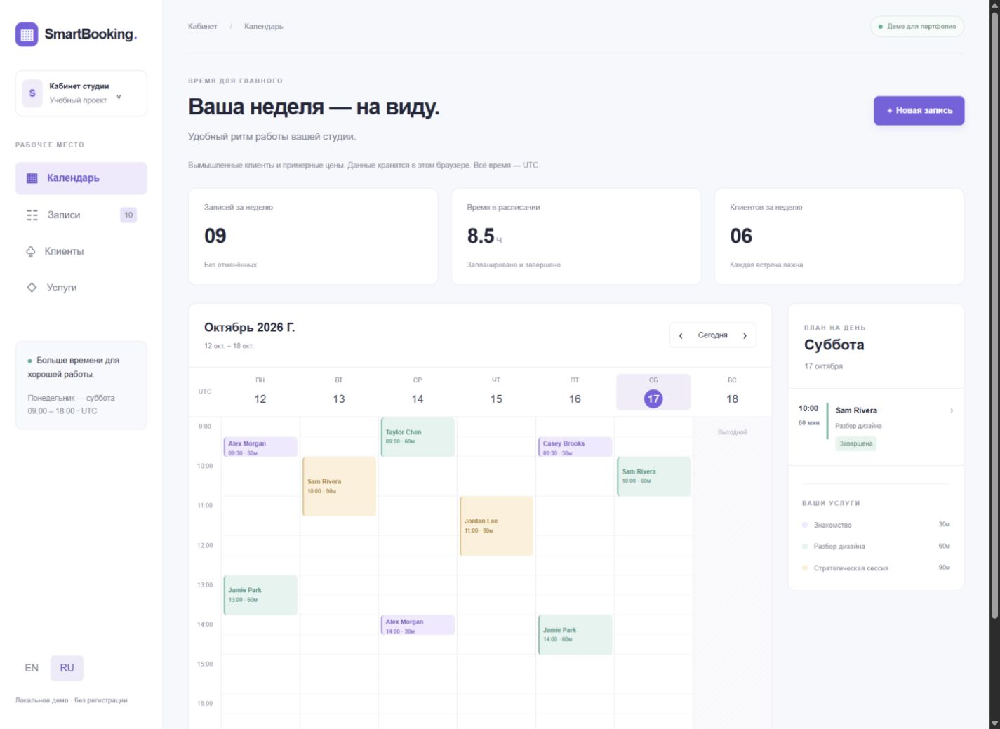

# SmartBooking

A bilingual studio scheduling workspace built with Next.js, React and TypeScript. An original portfolio demonstration, built with AI assistance. All clients and prices are fictional; this is not a deployed customer project.

## Run locally

Use Node.js 24 and pnpm. Install with `pnpm install --frozen-lockfile`, then `pnpm dev`. Open http://127.0.0.1:3101. On Windows, `Start-SmartBooking.ps1` starts the installed project. No environment secrets or accounts are required.

For production verification: `pnpm test`, `pnpm typecheck`, `pnpm build`, `pnpm start`. Set `NEXT_TELEMETRY_DISABLED=1` to disable Next.js telemetry (the Windows launcher does this).

## Features

- Weekly calendar and mobile daily agenda; previous/next week and today controls.
- Create, reschedule and cancel appointments; completed and cancelled history.
- Three session durations; availability checks include the full duration, closing hours, past dates and Sundays.
- Searchable booking list, status filter, client directory and service catalogue.
- English/Russian interface and saved language preference.
- Versioned localStorage persistence with schema validation. Corrupt data is not silently overwritten.
- Native modal dialog with keyboard dismissal, labelled inputs and reduced-motion support.

## Rules and architecture

One studio, one calendar, Monday–Saturday 09:00–18:00 UTC. Start times occur every 30 minutes. Sessions last 30, 60 or 90 minutes. Cancelled sessions release their slot; completed sessions remain in the calendar. Only future confirmed sessions can be rescheduled. Completion is allowed after the session ends.

`lib/booking.ts` contains deterministic domain functions; `lib/storage.ts` owns persistence and fresh-state validation on every change. Web Locks serialize mutations across tabs where supported; storage events refresh other tabs. Browsers without Web Locks are suitable for a single-tab demo only. Concurrent multi-device booking requires a real backend and transactional database constraints.

Data is stored under `smartbooking.demo.v1` in this browser profile and origin. Seed data is created once. Clearing site data removes it. No accounts, server database, emails, payments, analytics or external image/font requests are implemented. Do not enter real personal data. Prices are illustrative and are never charged. All dates use UTC deliberately to avoid implicit local-time conversion; timezone selection is future work.

## Portfolio

See `docs/CASE_STUDY.md`, `docs/QA.md` and the screenshots in `docs/`. The implementation demonstrates UI development, form validation, scheduling rules, state persistence, responsive layout and localisation. It does not claim commercial usage or customer results.
